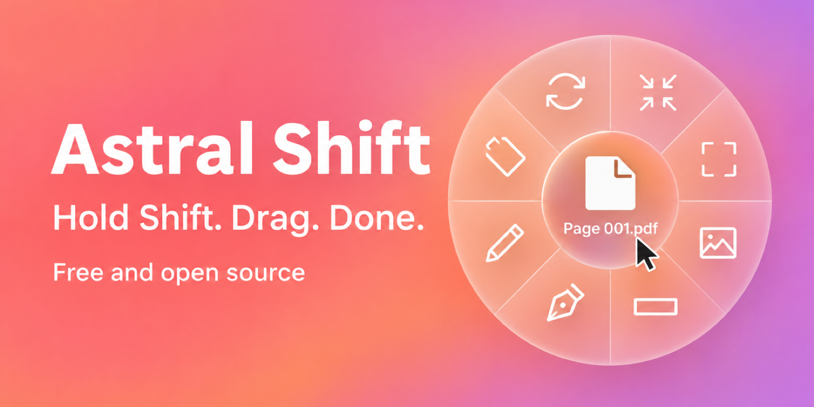
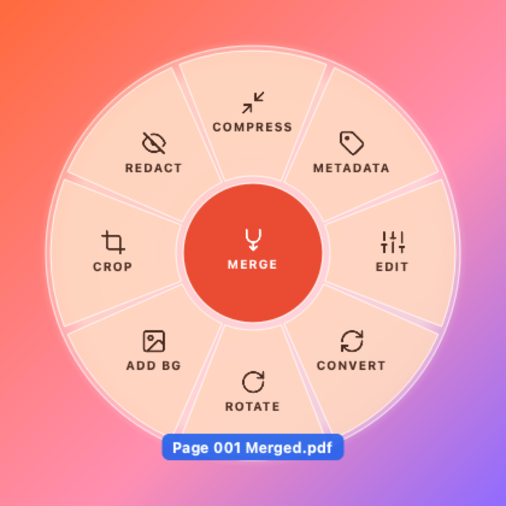
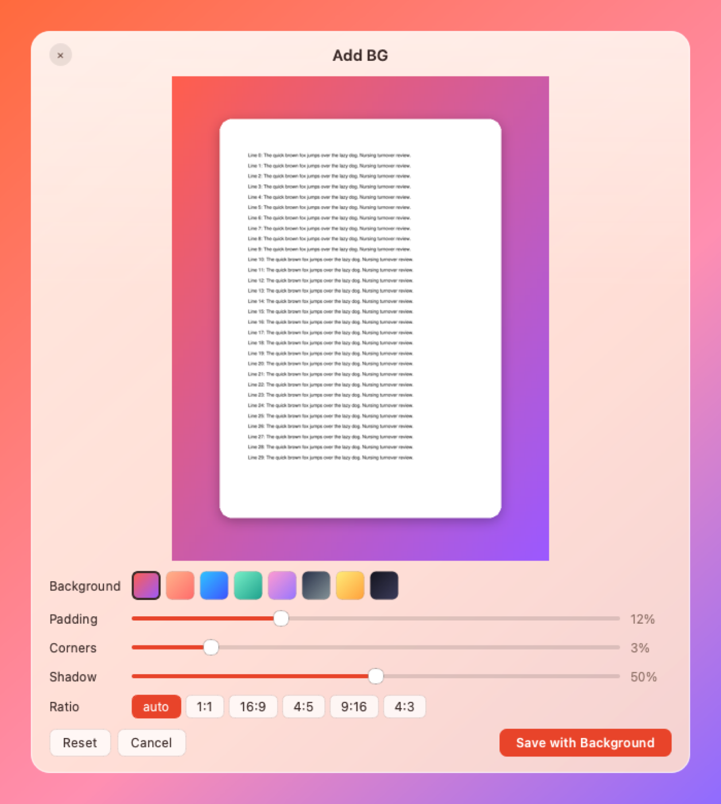
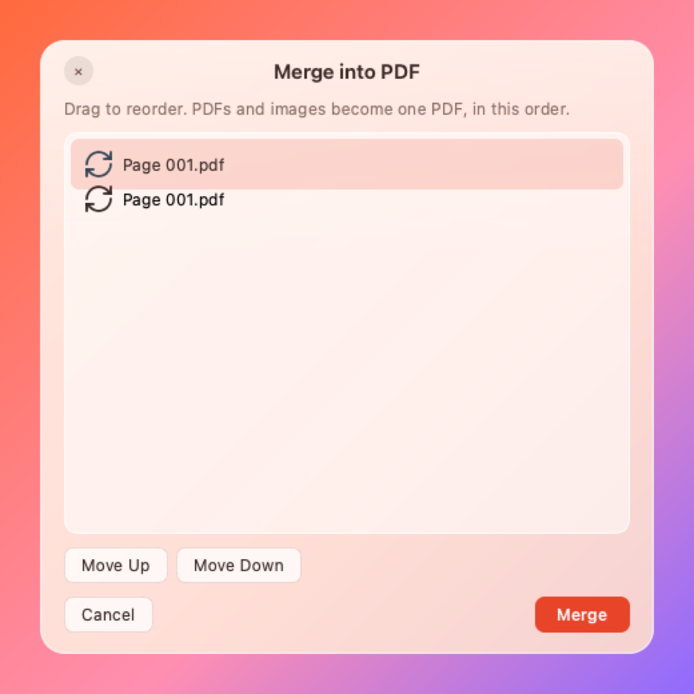
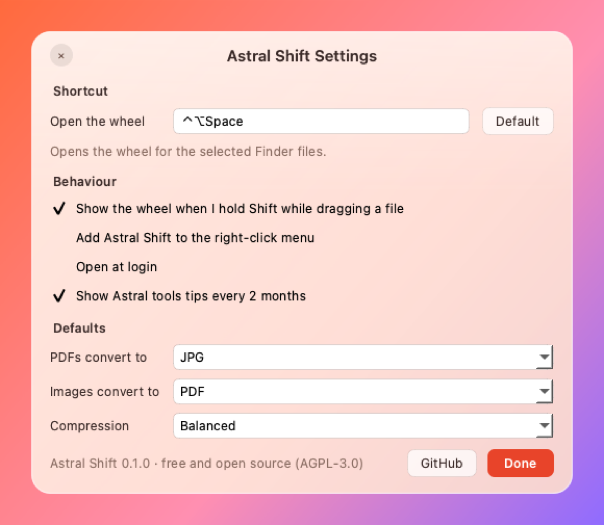

<p align="center"></p>

# Astral Shift

Hold **Shift** while dragging a PDF or image. A glass wheel opens around the cursor. Drop the file on a wedge and the result is saved next to the original.

Astral Shift is free and open source (AGPL-3.0) and runs on **macOS** and **Linux**. Everything happens on your machine, and no file is ever uploaded.

**Download:** [astralpdf.com/desktop](https://astralpdf.com/desktop) · [Latest release](https://github.com/jtaoufik/astral-shift/releases/latest)

<p align="center"></p>

## What the wheel does

| Wedge | Result |
|---|---|
| **Convert** | PDF to JPG/PNG/WebP (one image per page). Image to PDF/PNG/JPG/WebP. |
| **Compress** | Smaller PDFs (downsampled images, subset fonts) and images. A file that would grow is kept as is. |
| **Crop** | Drag a frame or pick a ratio (1:1, 16:9, 4:3…). For a PDF, the crop applies to every page. |
| **Rotate** | 90° clockwise in one drop. |
| **Add BG** | Puts the file on a gradient with padding, rounded corners and a shadow, and saves a PNG. |
| **Redact** | Draw boxes. For a PDF the text, vectors and image pixels underneath are **removed**, not just covered. |
| **Edit** | Rotate, flip, resize, brightness, contrast, saturation, black and white. For a PDF: rotate or **split into pages**. |
| **Metadata** | Shows author, software, GPS, dates and XMP, and saves a clean copy without them. |
| **Annotate** (centre) | Pen, highlighter, boxes, arrows and text. |
| **Merge** (centre, 2+ files) | Joins PDFs and images into one PDF, in the order you choose. |

Results never overwrite anything: `Page 001.pdf` becomes `Page 001.jpg`, `Page 001 Cropped.pdf`, `Page 001 Merged.pdf`…

<p align="center">
  
  
</p>

## Three ways to open the wheel

1. **Shift + drag** any PDF or image, from Finder, the desktop, Nautilus, Dolphin…
2. **Keyboard shortcut**: ⌃⌥Space on macOS, Ctrl+Alt+Space on Linux. You can change it in Settings. On macOS the wheel opens for the files selected in Finder, so you click a wedge instead of dropping.
3. **Right-click menu**: turn on *Add Astral Shift to the right-click menu* in Settings. On macOS this adds a Finder Quick Action. On Linux it adds a Nautilus script, a Dolphin service menu and a Nemo action.

<p align="center"></p>

### Permissions

macOS needs **no Accessibility or Input Monitoring permission**. Astral Shift only reads state the OS already shares with every app: whether the mouse button and Shift are down, and whether a drag has started. The first time the shortcut reads your Finder selection, macOS asks once whether Astral Shift may talk to Finder.

On **Linux X11**, Shift+drag and the shortcut work out of the box. **Wayland** doesn't let apps watch global input, so use the tray icon, or bind `astral-shift wheel` to a shortcut in your desktop's keyboard settings.

## Command line

The same operations are available from a terminal:

```sh
astral-shift convert "Page 001.pdf" --to png
astral-shift compress scan.pdf --level high
astral-shift merge cover.pdf photo.jpg report.pdf --out all.pdf
astral-shift split report.pdf
astral-shift crop photo.jpg --rect 0.1 0.1 0.9 0.9
astral-shift redact contract.pdf --rect 0.1 0.2 0.6 0.25 --page 2
astral-shift background shot.png --preset ocean --ratio 16:9
astral-shift metadata photo.jpg --strip
astral-shift wheel file.pdf      # open the wheel for a file
```

## Install from source

```sh
git clone https://github.com/jtaoufik/astral-shift
cd astral-shift
python3 -m venv .venv && .venv/bin/pip install -e ".[dev]"
.venv/bin/astral-shift            # starts the menu-bar / tray app
```

You need Python 3.10 or newer. On Linux you also need the Qt xcb libraries (on Debian/Ubuntu: `libxcb-cursor0`).

## Development

```sh
.venv/bin/python -m pytest        # every test, with 100% line coverage enforced
```

- `src/astral_shift/ops/`: the file operations (PyMuPDF and Pillow), with no UI code.
- `src/astral_shift/gui/`: the wheel, the dialogs, the glass windows, the global shortcut, the Shift+drag watcher and the file-manager integrations.
- `src/astral_shift/cli.py`: the command line.

Pull requests are welcome. Keep coverage at 100%.

## More free tools

Astral Shift is part of the Astral family. These tools also run in your browser:

- [AstralPDF](https://astralpdf.com): merge, split, compress, unlock and watermark PDFs
- [AstralText](https://astraltext.com): clean AI text, strip Markdown, fix spacing
- [AstralJSON](https://astraljson.com): prettify, compare and validate JSON
- [AstralBatch](https://astralbatch.com): batch image tools

## License

[GNU AGPL-3.0](LICENSE). Astral Shift uses [PyMuPDF](https://pymupdf.readthedocs.io) (AGPL), [Qt for Python](https://doc.qt.io/qtforpython/) (LGPL) and [Pillow](https://python-pillow.org) (HPND).
